## How to open this deck (Slides Extended)

1. Install / enable community plugin **Slides Extended** (fork of Advanced Slides).
2. Open this note: `Project/Challenges and Solutions.md`.
3. Command palette → **Slides Extended: Show slide preview** (wording may vary slightly by version).
4. Click into the preview, then use **arrow keys**. Press **O** for overview.

**Separators:** a line that is only `---`, with a blank line above and below, starts a new horizontal slide.

**Speaker script:** [[Challenges Presentation Script]]

**If preview is blank:** close preview, ensure this file’s YAML frontmatter has no custom `separator` regex, then reopen preview.

---

## SLF-EWN

### Engineering challenges, quantitative analysis, and design responses

**Subterranean Landslide and Flood Early-Warning Network**

| Item | Content |
|:-----|:--------|
| Problem domain | Subsurface moisture and motion before slope failure |
| Hardware | ATmega328P · ADXL345 · capacitive moisture · Ra-02 (SX1278) 433 MHz · W25Q64 · 1-layer THT |
| Software | Bare-metal AVR-GCC · Qt 6 / QML host |
| Method on every topic | **Problem → analysis (equations / limits) → implementation → residual risk** |

Technical design presentation — full detail

*Presenter tip: Long-form technical deck. Use overview (O) to jump sections; each slide is self-contained.*

---

## How this deck is organised

| Section | Topics |
|:--------|:-------|
| **A** | Architecture, constraints, method |
| **B** | Air frame size and protocol |
| **C** | Why sub-GHz and why LoRa |
| **D** | Zones, tracking, thresholds, **capacitive vs resistive moisture** |
| **E** | Energy: cell, duty cycle, P-MOSFET, supercap |
| **F** | Dual wake: WDT and accelerometer INT |
| **G** | Soil path loss, antenna, PCB RF noise |
| **H** | PCB size, 1-layer rules, HF placement |
| **I** | Flash, collisions, pre-flash, encryption |
| **J** | Risk register, validation order, conclusions |

**Related project notes:** [[Project Overview]] · [[Firmware Hub]] · [[Code Hub]] · [[Dashboard Hub]] · [[Status and open issues]] · [[Full Proposal]]

---

## A1 — System architecture

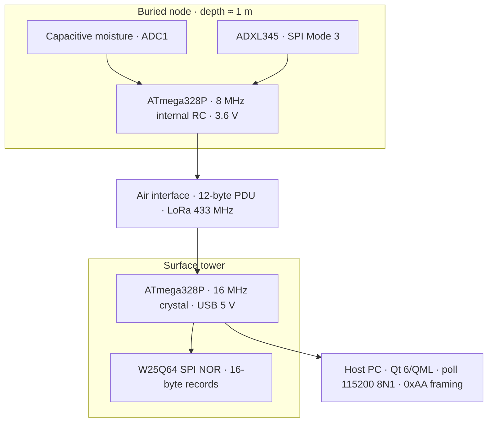

**End-to-end behaviour**

1. Node wakes on timer or motion interrupt, enables sensor/radio rail, samples, packs a **12-byte** frame, transmits, returns to power-down.
2. Tower validates CRC, appends a **16-byte** flash record (record ID + PDU).
3. Host **polls** the tower; it does not rely on an unsolicited 12-byte stream.
4. Host maps **Device ID** to zones, thresholds, and map pins in SQLite.

---

## A2 — Segment parameters

| Segment | Clock / power | Primary responsibility |
|:--------|:--------------|:-------------------------|
| Node | 8 MHz RC, Li-SOCl₂ 3.6 V | Sense, pack, TX, µA-class sleep |
| Air | 433 MHz LoRa (SX1278 / Ra-02) | Fixed 12-byte payload through soil then air |
| Tower | 16 MHz, USB → 3.3 V | Continuous RX path, NOR log, command server |
| Host | Desktop | Places/zones, per-node limits, charts, map |

**Production vs simulation**

- Same application-level frame layout in field and Proteus.
- Proteus may use fake SPI slaves (`0x8D` FIFO path); field firmware uses real SX1278 registers.
- Do not ship the simulation-only SPI contract to hardware.

---

## A3 — Global design constraints

| Constraint | Quantitative / hard bound | Design consequence |
|:-----------|:--------------------------|:-------------------|
| Service life | 3–7 years without opening capsule | Primary cell; average current in low µA |
| Burial | ≈ 1 m | Soil RF path + subsurface moisture/tilt |
| PCB process | **1 copper layer**, 100% THT | Jumpers only; no 2-layer escape routing |
| MCU | ATmega328P, bare-metal C | Fixed binary protocols; no RTOS |
| Air occupancy | Prefer short time-on-air | Fixed 12-byte PDU |
| Tower autonomy | PC may be disconnected | SPI NOR logging, not host-side filesystem |
| Parts | Local distributor shelf | ADXL345 adopted; LIS3DH remains future option |

**Assumptions called out later:** soil attenuation coefficients are **literature-scale** until barrel/pit calibration; sleep current is **designed** but must be **measured** on hardware.

---

## A4 — Method used on every challenge

| Step | Question answered on the slide |
|:-----|:-------------------------------|
| **1. Problem** | Which requirements conflict? |
| **2. Analysis** | Equation, datasheet limit, or literature bound? |
| **3. Implementation** | What is in schematic, firmware, or Qt **now**? |
| **4. Status** | Verified / designed / open measurement or code? |

This keeps the review auditable: numbers first, then the part choice, then residual risk.

---

## B1 — Frame size: problem

### Observability versus energy, collisions, and soil margin

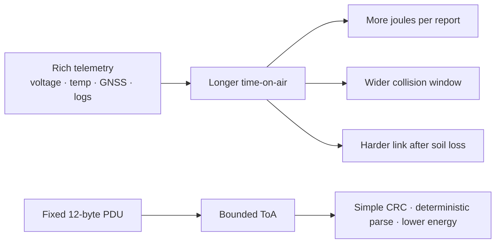

**Problem.** A geotechnical wishlist wants many fields. A buried node on a primary cell, sharing one LoRa demodulator with neighbours, and pushing energy through wet soil, cannot treat payload size as free.

**Design decision.** Freeze a **12-byte** protocol data unit (PDU) with CRC-8. Put GIS, labels, and rich history on the **host**, not in every RF packet.

---

## B2 — Frame size: bit-level layout

```
Offset   0         2         4         6         8        10    11
         [ ID u16 ] [ moist ] [ X i16 ] [ Y i16 ] [ Z i16 ] [st] [crc]
         multi-byte fields are big-endian
```

| Offset | Type | Semantic | Notes |
|:------:|:-----|:---------|:------|
| 0–1 | u16 BE | Device ID | Default `0x0104` |
| 2–3 | u16 BE | Moisture 0…10000 | From 10-bit ADC scaled in firmware |
| 4–5 | i16 BE | Axis X | Tilt / acceleration encoding |
| 6–7 | i16 BE | Axis Y | |
| 8–9 | i16 BE | Axis Z | Host uses max \|axis\| vs angle thresholds |
| 10 | u8 | Status | `0x80` = emergency (INT) wake; seq; accel fault bit |
| 11 | u8 | CRC-8 | Poly-style `0x07`, init `0x00`, over bytes 0–10 |

Tower **discards** frames failing CRC. Same 12 bytes appear inside each 16-byte flash record.

Canonical tables: [[Firmware Hub#Data formats]]

---

## B3 — Frame size: host and storage wrappers

| Layer | Size | Contents |
|:------|:-----|:---------|
| Air PDU | **12 B** | ID, moisture, XYZ, status, CRC |
| Flash record | **16 B** | u32 record ID ‖ copy of 12 B PDU |
| USB reply | variable | Magic **`0xAA`** ‖ cmd ‖ u32 length ‖ payload |

**Why wrappers exist**

- Flash needs a monotonic record index for dump/incremental poll (`'D'` / `'N'`).
- USB must support **command/response** (status, full dump, incremental, clear)—not a continuous 12-byte firehose.
- Host can structure polling between commands.

**Open if encryption is added:** ciphertext expansion changes ToA and possibly flash record size; both must be re-budgeted.

---

## C1 — Why not 2.4 GHz for a buried node

### Carrier frequency and soil attenuation

Wet soil is a **lossy dielectric**. In the bands used by compact IoT radios, path loss through wet clay **worsens as frequency rises**.

| Technology | Typical role | Fit for 1 m wet soil + long life? |
|:-----------|:-------------|:----------------------------------|
| Wi-Fi 2.4 GHz | High throughput, AP infrastructure | No — energy, association, soil loss |
| BLE 2.4 GHz | Short-range PAN | No — range and soil path |
| LoRa 2.4 GHz | Some modern modules | Better protocol, still higher soil loss than sub-GHz |
| **LoRa 433 MHz** | Low-rate long-range ISM | **Yes — selected** |

**Literature-scale attenuation (wet clay, sub-GHz):**

$$
\alpha \sim 10\text{–}40\ \mathrm{dB\,m^{-1}}
\quad\Rightarrow\quad
L(d{=}1\,\mathrm{m}) \sim 20\text{–}40\ \mathrm{dB}
$$

**Segment targets used in design**

| Segment | Target |
|:--------|:-------|
| Vertical through soil | ≈ **1 m** |
| After breakout (air) | **100–200 m** with elevated tower antenna |

Open-air LoRa marketing figures (many km) **do not** apply to the buried metre.

---

## C2 — Why LoRa modulation (CSS), not any 433 MHz FSK

### Sensitivity at low information rate

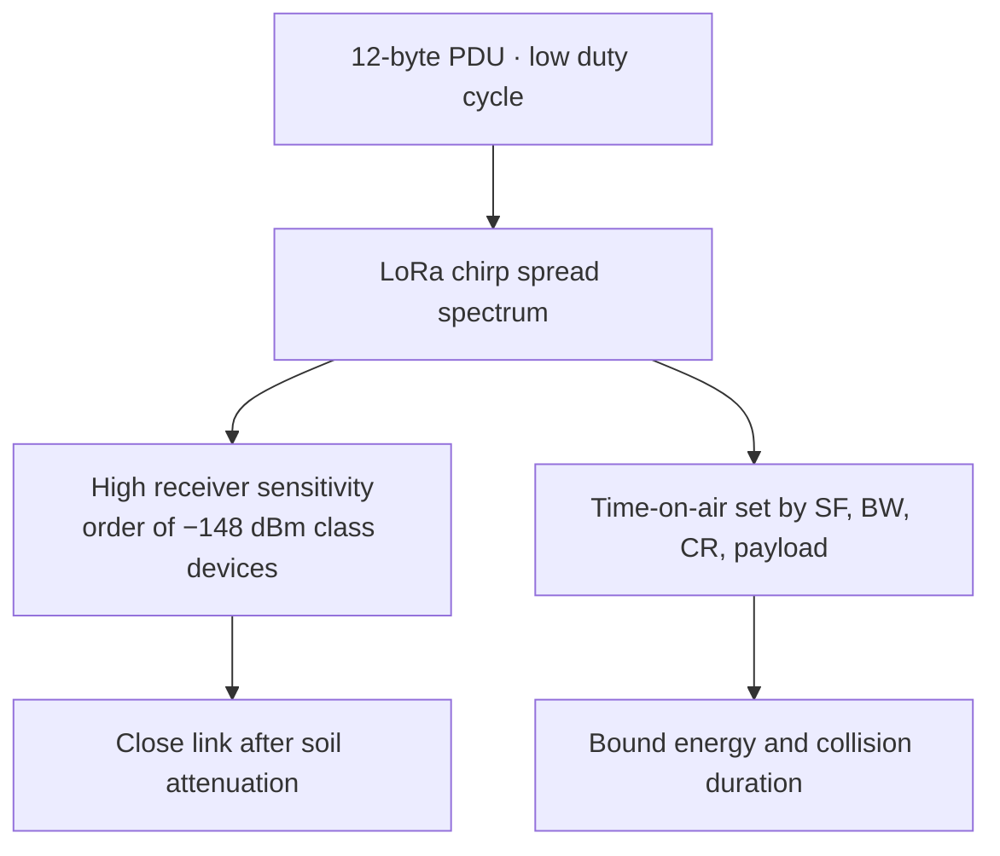

| LoRa property | Use in SLF-EWN |
|:--------------|:---------------|
| High sensitivity | Recovers weak post-soil signals |
| Low bit rate acceptable | Telemetry is small and infrequent |
| Configurable SF/BW | Trade ToA vs robustness (SF7–9 class target) |
| SX1278 ecosystem | SPI control from AVR; Ra-02 module on shelf |

**What we do not need from LoRa:** video, IP mesh, or phone-centric provisioning.

**Implementation:** Ra-02 (SX1278) on 2.54 mm headers; production drivers in `transmitter_lora.c` / `receiver_radio.c`; RF settings must match on both ends (frequency, SF, BW, sync, etc.).

---

## C3 — RF configuration checklist

| Parameter | Design target |
|:----------|:--------------|
| Frequency | **433.0 MHz** ISM |
| Module | **Ra-02** (SX1278) |
| Spreading / bandwidth | SF7–9 class, **125 kHz** (TX/RX matched) |
| TX power | ≈ **14–20 dBm** (PA_BOOST class) |
| Payload | **12 bytes** + CRC policy as implemented |
| ToA preference | **&lt; 500 ms** per packet when possible |
| Tower antenna | Vertical polarisation, **1.5–2 m** AGL, omni |

**Conceptual link budget**

$$
P_{\mathrm{rx}} = P_{\mathrm{tx}} + G_{\mathrm{tx}} + G_{\mathrm{rx}} - L_{\mathrm{soil}} - L_{\mathrm{air}} - L_{\mathrm{misc}}
$$

**Status:** architecture and drivers exist; **measured path loss on our helix + soil is still open (H4)**.

---

## D1 — Zones and identity: problem

### RF packets cannot carry a full GIS model

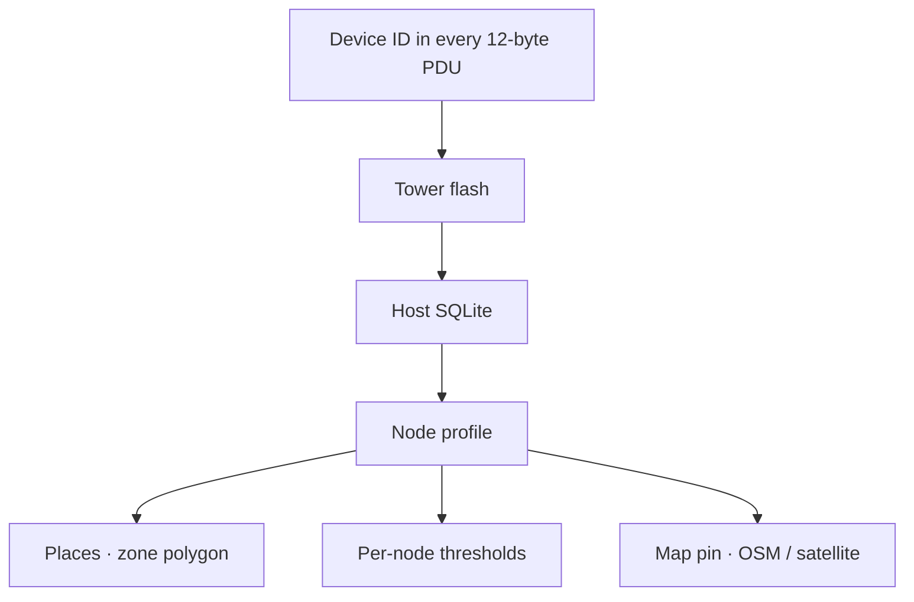

**Problem.** Operators need site name, zone, category (mine wall vs village slope), and map position. Putting all of that on-air would enlarge the PDU and still not replace a real GIS database.

**Split of responsibility**

| Information | Lives where | Why |
|:------------|:------------|:----|
| Who transmitted | **Device ID** on air + flash | Stable primary key, 2 bytes |
| Zone / place name | Host **Places** | Polygons, labels, no ToA cost |
| Category | Host profile / planning | Drives default thresholds |
| Coordinates | Host map (click or lat/lon) | No GNSS in node BOM |

---

## D2 — Tracking after a landslide

### Geometry can change; identity must not


**Problem.** A real failure may move the capsule. If identity were tied only to map coordinates, time-series continuity would break.

**Stable after the event**

- Device ID in firmware and every PDU
- NOR and SQLite history keyed by ID
- Emergency status when motion INT wakes the node

**Expected to be updated by humans after survey**

- Map pin position
- Zone membership if the node leaves a polygon
- Interpretation of tilt relative to a new rest attitude

**Residual limitation:** no onboard GNSS — displacement is **not** estimated in the node; only motion **detection** + ID-continuous logging.

---

## D3 — Why moisture and tilt at about 1 m depth

### Surface instruments often see failure late

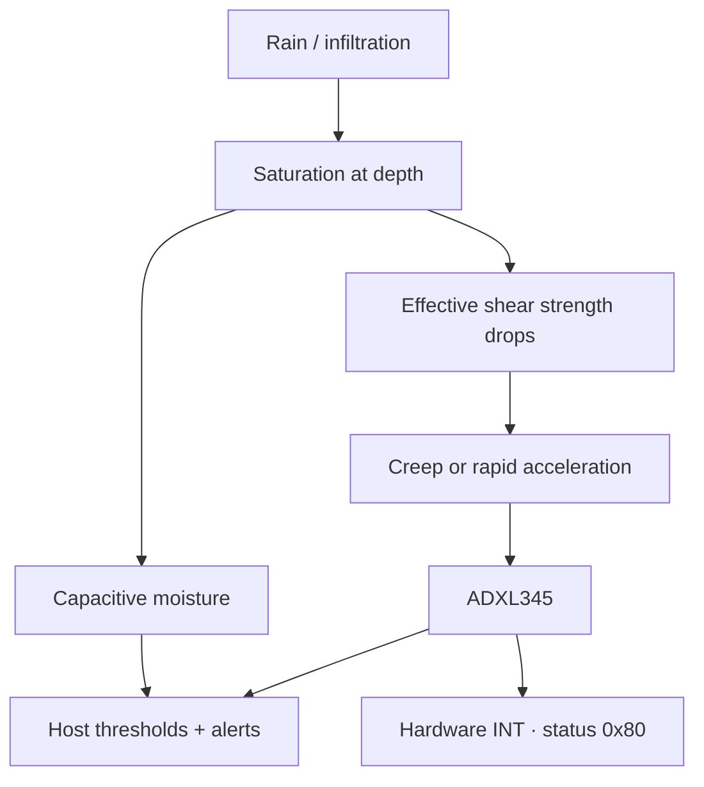

| Observable | Engineering role | Explicit non-role |
|:-----------|:-----------------|:------------------|
| Moisture | Saturation **proxy** | Full hydro-mechanical FEM |
| Tilt / shock | Deformation / impact **indicator** | Survey-grade inclinometer log |
| Depth ≈ 1 m | Design burial + defines soil RF path | Variable-depth instrument string |
| Overburden / weight | **Site category** in planning | On-node load cell |

This build is an **instrumented early-warning prototype**, not a replacement for a full slope-stability study.

---

## D3b — Moisture probe: why not resistive?

### Resistive probes fail in permanent wet soil

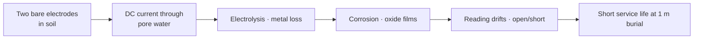

| Issue | What happens with a **resistive** (conductivity) probe |
|:------|:------------------------------------------------------|
| **Galvanic path** | Measurement injects current through the soil between exposed metal |
| **Electrolysis** | Wet soil acts as electrolyte → electrode material dissolves or plates |
| **Corrosion** | Oxide and deposits change resistance → false “dry/wet” |
| **Maintenance** | Probes need cleaning or replacement — conflicts with **3–7 year sealed** goal |
| **Long bias** | If left powered, corrosion accelerates |

**Problem for SLF-EWN.** A sealed node at ≈ 1 m for years cannot accept a sensor that **eats itself** in the same water we are trying to measure.

---

## D3c — Capacitive moisture: design response

### Insulated electrodes · dielectric sensing · gated power

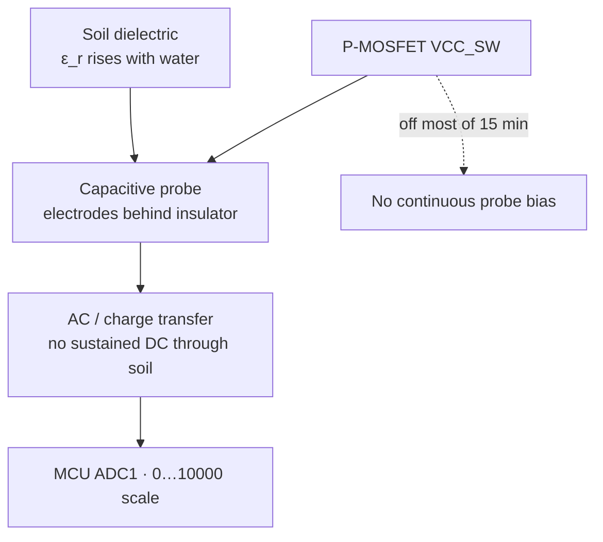

| Decision | Why it helps |
|:---------|:-------------|
| **Capacitive (v1.2 class) probe** | Senses change in **dielectric constant**; metal is not a DC electrode pair in the pore water |
| **Insulated contact with soil** | Greatly reduces electrolysis vs bare resistive forks |
| **Power only on VCC_SW** | Probe is biased only for the short measure window — less continuous electrochemical stress |
| **Sealed capsule + potting path** | Mechanical isolation of electronics from free water |
| **Host calibration / invert (F3)** | Map ADC to display %; fix polarity for this probe family |

**Status.** Capacitive part is **selected and in the BOM**. Residual work: two-point wet/dry calibration and polarity invert in firmware (**F3**), not a change of sensor physics.

**Not claimed.** Laboratory-grade volumetric water content (VWC) with temperature compensation — the node reports a **saturation proxy** for thresholds, not a metrology certificate.

---

## D4 — Threshold hierarchy

### One global limit is wrong for every site

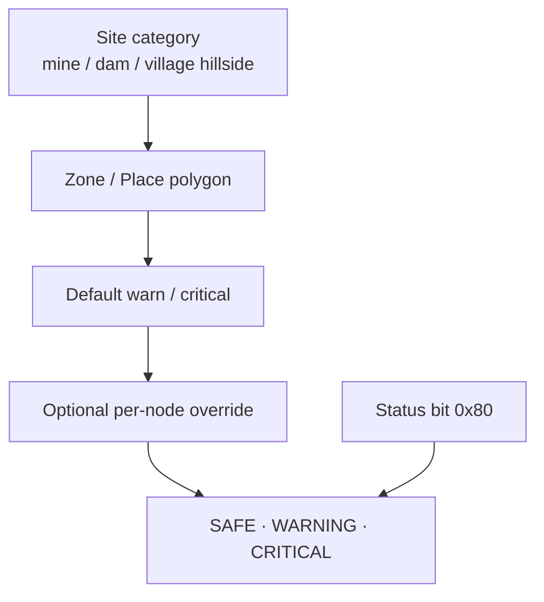

**Host defaults in the current software**

| Quantity | Warning | Critical |
|:---------|:-------:|:--------:|
| Moisture (display %) | **38** | **58** |
| Tilt magnitude max of absolute axes in degrees | **8°** | **16°** |
| Status `0x80` (motion-INT wake) | — | **Always CRITICAL** |

**Implemented in Qt:** node cards, alert log, Places, optional per-node limits, charts ([[Dashboard Hub]]).

**Open as workflow:** one-click **category templates** that bulk-apply defaults (mechanism for per-node limits already exists).

---

## E1 — Energy: problem statement

### Peak PA current versus multi-year average current

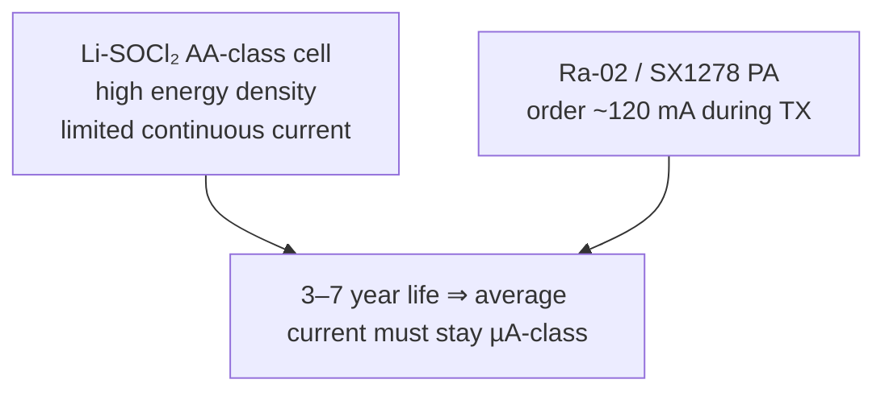

**Problem.** The chemistry that survives years underground cannot source LoRa PA peaks continuously. Leaving the radio or moisture sensor biased between reports would dominate the lifetime budget.

**Architecture response (following slides):** primary cell for energy, supercap for peaks, P-MOSFET to remove load bias, long WDT period, motion wake without powering LoRa until needed.

---

## E2 — Energy: cell capacity and average-current bound

**Stored energy (order of magnitude)**

$$
E \approx 3.6\,\mathrm{V} \times 2.4\,\mathrm{Ah} = \mathbf{8.64\,\mathrm{Wh}}
$$

**Hard upper bound on average current for 7 years** (neglect self-discharge):

$$
I_{\mathrm{avg,max}}
= \frac{2400\,\mathrm{mAh}}{7 \times 365 \times 24\,\mathrm{h}}
\approx \mathbf{39\,\mu\mathrm{A}}
$$

| Parameter | Design value | Rationale |
|:----------|:-------------|:----------|
| Chemistry | Li-SOCl₂ | Flat voltage, low self-discharge, temperature range |
| Self-discharge | &lt; 1 %/year typ. @ 20 °C | Calendar life |
| Target $I_{\mathrm{avg}}$ | **&lt; 10 µA** | Margin for cold, PCB leakage, ageing |
| BOD fuses | Off / 1.8 V class | Avoid 2.7 V BOD lock as cell ages |
| Disconnect | 2-pin jumper | Zero drain in storage; no dirt-filled switch |

---

## E3 — Energy: duty cycle — why sleep dominates

Take active window $\Delta t_{\mathrm{on}} \approx 50\,\mathrm{ms}$ and production period $T = 15\,\mathrm{min} = 900\,\mathrm{s}$:

$$
D = \frac{\Delta t_{\mathrm{on}}}{T} = \frac{0.05}{900} \approx \mathbf{5.6 \times 10^{-5}}
$$

If the active window draws $I_{\mathrm{on}} \approx 30\,\mathrm{mA}$ average:

$$
I_{\mathrm{on,avg}} = D \cdot I_{\mathrm{on}} \approx \mathbf{1.7\,\mu\mathrm{A}}
$$

**Interpretation for the review**

- Charge spent while awake is **small** in the yearly integral
- **Hibernate current** (MCU power-down + leakages + any always-on accel mode) decides success
- Therefore every always-on microamp needs a safety justification (e.g. motion INT)

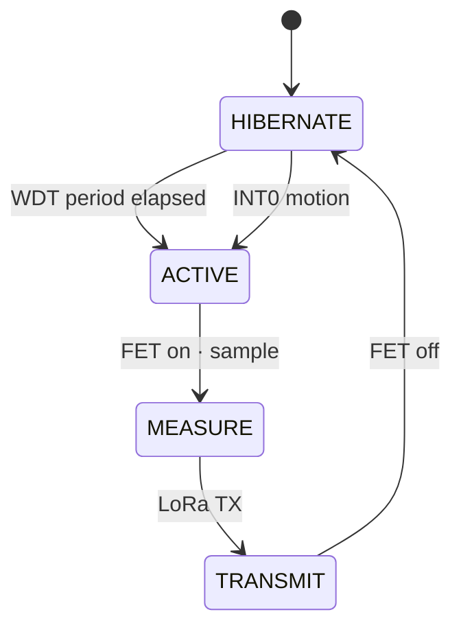

---

## E4 — P-MOSFET load switch (moisture + LoRa)

### High-side power gating

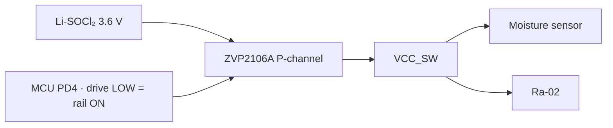

| Mode | Gate | Moisture and LoRa |
|:-----|:-----|:------------------|
| Hibernate | Held off (pull-up to VCC) | **Unpowered** — no quiescent module current |
| Measure / TX | Driven on for a short window | Powered only when needed |

**Why P-MOS high-side**

- Interrupts the **positive** supply to hungry loads
- Suitable TO-92 leakage is far below leaving modules in standby
- Pull-up keeps the rail off during MCU reset

**Part in BOM:** ZVP2106A (not a random SMD FET that violates the THT / shop constraint).

---

## E5 — Supercap for the TX current edge

Cell average current is microamps; PA wants ~**120 mA** for milliseconds.

**Charge for 120 mA × 2 ms**

$$
\Delta Q = I \Delta t = 0.12\,\mathrm{A} \times 0.002\,\mathrm{s} = \mathbf{240\,\mu\mathrm{C}}
$$

**Voltage dip**

$$
\Delta V = \frac{\Delta Q}{C}
$$

| $C$ | $\Delta V$ | Verdict |
|:----|:-----------|:--------|
| 100 µF | 2.4 V | Unacceptable on a 3.6 V rail |
| **1 F** | **240 µV** | Negligible |

**Implementation:** parallel **1 F / 5.5 V** supercap (avoid a 3.6 V memory-backup cap held at rated voltage for years). Cell trickle-charges the cap between wakes; cap supplies the PA edge.

**Status:** topology designed; **true sleep current on hardware still open (H3)**; production must clear **`SIM_FAST_WAKE` (F1)**.

---

## F1 — Dual wake: problem

### Pure timer sampling misses rapid onset

If the node only wakes every 15 minutes and **all** motion sensing is powered down, a fast failure between samples is invisible until the next WDT wake.

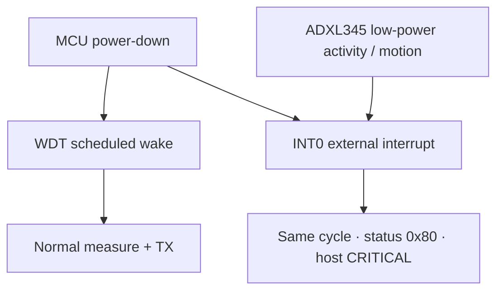

**Problem.** Safety-relevant sudden-slide detection conflicts with switching everything off for µA sleep.

**Resolution principle.** Gate **moisture and LoRa** hard; keep a **motion-capable** accel configuration and MCU INT0 alive; treat INT wakes as emergency in the PDU and UI.

---

## F2 — Dual wake: implementation behaviour

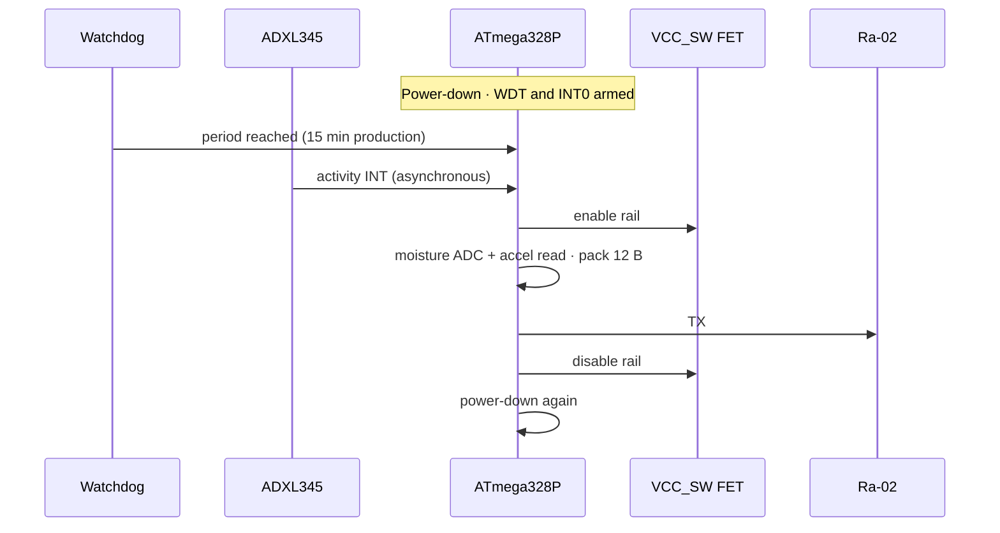

| Wake source | Meaning | Host effect |
|:------------|:--------|:------------|
| WDT | Scheduled telemetry | Normal thresholds |
| INT0 from accel | Sudden movement | Status `0x80` → **CRITICAL** |

**Production interval:** 15 minutes via WDT 8 s ticks (112 ticks ≈ 14.9 min).
**Simulation:** `SIM_FAST_WAKE` forces ~8 s — **must be off in field builds**.

**Open (F8):** characterise ADXL345 activity threshold, axis mapping, and current in the chosen low-power INT mode on real silicon.

---

## G1 — Soil path loss: analysis

$$
L_{\mathrm{soil}} \approx \alpha \cdot d
\quad\text{with}\quad
\alpha \sim 10\text{–}40\ \mathrm{dB\,m^{-1}},\quad
d \approx 1\ \mathrm{m}
$$

so the first metre alone can cost **20–40 dB** before the wave reaches air. After breakout, the problem becomes ordinary surface propagation plus antenna gains.

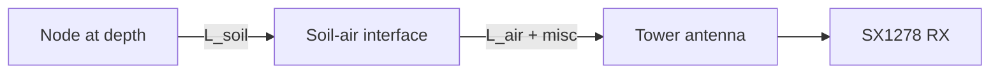

**Design levers (priority for this project)**

1. Sub-GHz carrier (433 MHz)
2. Buried antenna dielectric (air pocket)
3. Polarisation match (vertical–vertical)
4. Tower height 1.5–2 m AGL
5. Short ToA / adequate TX power

**Status:** levers implemented in design; **α for our soil still unmeasured (H4)**.

---

## G2 — Antenna: electrical length and clay

**Free-space quarter-wave** at 433 MHz, $VF \approx 0.95$:

$$
\frac{\lambda}{4}
= \frac{c}{4f}\cdot VF
= \frac{3\times 10^{8}}{4\times 433\times 10^{6}}\times 0.95
= \mathbf{16.45\ \mathrm{cm}}
$$

**In a dielectric**

$$
\lambda_{\mathrm{med}} = \frac{\lambda_0}{\sqrt{\varepsilon_r}}
$$

| Medium | $\varepsilon_r$ (order) | Effect on a ~16.5 cm wire |
|:-------|:----------------------:|:--------------------------|
| Air cavity | ≈ 1 | Resonance remains usable |
| Wet clay | ≈ 30 | Scale toward **~3 cm**; $\varepsilon_r$ moves with moisture |

**Hard requirement:** the radiating element must live in an **air pocket** for the life of the installation—not packed in clay.

---

## G3 — Antenna: geometry

| Parameter | Specification |
|:----------|:--------------|
| Type | Helix |
| Wire | Solid copper, cut ≈ **17.0 cm** |
| Mandrel | **5 mm** |
| Turns | ≈ **18–22** close-wound |
| Wound height | ≈ **3.5 cm** (capsule headroom) |
| Environment | Air cavity under top cap |
| Feed | Short board ANT → **SMA-TH** |

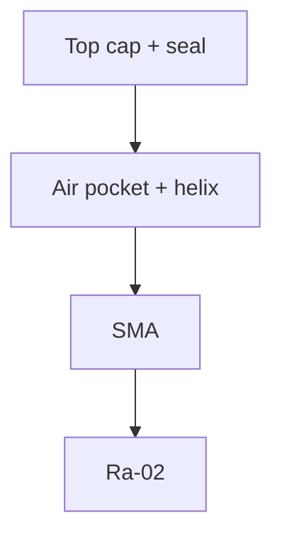

---

## G4 — Antenna: orientation and mechanical order

Polarisation mismatch discards link margin already spent on soil loss.

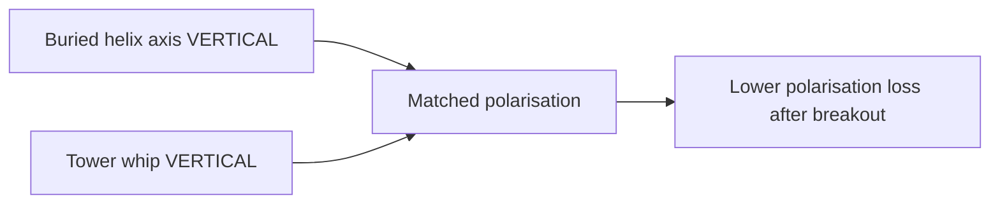

| Rule | Implementation |
|:-----|:---------------|
| Helix axis | **Vertical** |
| Tower whip | **Vertical** omni, 1.5–2 m AGL |
| Capsule | Installed **level** |
| Stack order | Electronics → short RF feed → SMA → helix in upper air volume |

**Status:** rules frozen; final **VSWR / range in assembled capsule open**.

---

## G5 — PCB as an EMI source into the antenna

### Self-interference on a 50×50 mm one-layer board

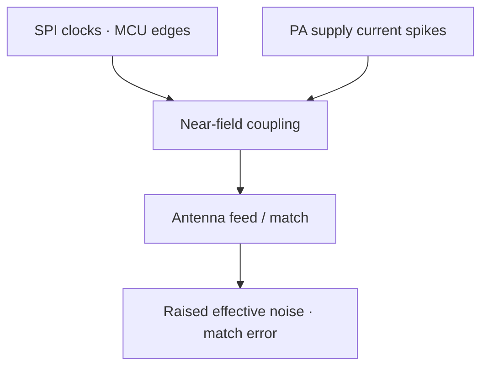

**Problem.** The same small board hosts digital SPI (accel + radio) and a sensitive 433 MHz path. Poor layout spends decibels **before** the wave enters soil.

**Specified mitigations**

| Practice | Purpose |
|:---------|:--------|
| Minimum length ANT → SMA | Loss and loop area |
| 0.1 µF at MCU VCC/AVCC; bulk 10–100 µF at radio VCC | Digital and PA supply integrity |
| Moisture ADC route spatially away from RF/digital | Protect 10-bit samples |
| Ground pour where 1-layer allows | Return path |
| Headered Ra-02 | Controlled placement, field replacement |

**Status:** rules in EasyEDA notes; **post-fab RF/noise measurement open**.

---

## H1 — Transmitter PCB size and capsule

| Parameter | Value |
|:----------|:------|
| TX PCB | **50 × 50 mm**, 1-layer THT |
| Capsule ID | **50–75 mm** (clear board + SMA) |
| Length | **200–300 mm** class |
| Section | **Circular** — load distribution, auger installation |

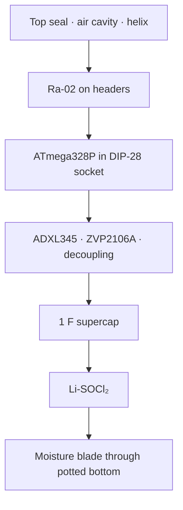

Rectangular boxes concentrate stress at corners under freeze–thaw; the cylinder matches the inline stack.

**Status:** dimensions locked; **SolidWorks deliverables open (M1)**.

---

## H2 — Single-layer PCB technology

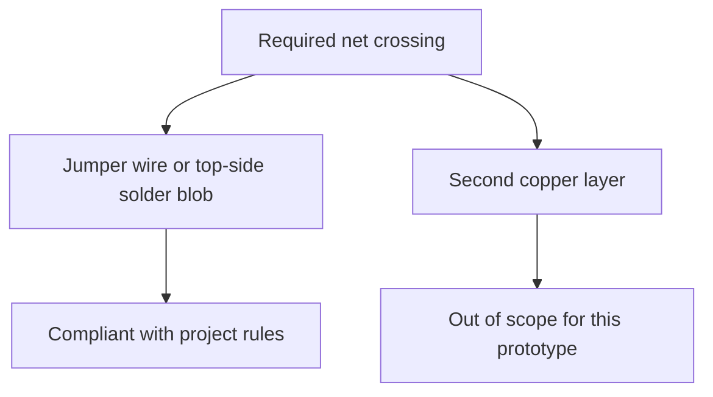

| Rule | Specification |
|:-----|:--------------|
| Layer count | **1** |
| Power traces | **30–40 mil** on high-current paths |
| Signal traces | ≈ **10 mil** |
| Decoupling | 0.1 µF within **5 mm** of VCC and AVCC |
| MCU | DIP-28 **socket** — pre-flash in lab |
| Modules | 2.54 mm female headers preferred |
| RX board | **95 × 70 mm** class |

Driven by cost, student fab process, and field repair—not only RF theory.

**Status:** layout in review; **fab not ordered (H1)**.

---

## H3 — Placement for high-frequency and analogue integrity

| Cluster | Include | Goal |
|:--------|:--------|:-----|
| **Hot** | MCU SPI, radio SPI, local ceramics, PA bulk | Minimise loop area and supply bounce |
| **Quiet** | Moisture analogue route, probe pads | Reduce digital/RF coupling into ADC |
| **Power** | Cell, supercap, FET, wide traces | Support ~120 mA edges without collapse |

```mermaid
flowchart LR
  subgraph hot["Tight"]
    MCU[MCU]
    RF[Radio]
    DEC[Decoupling]
  end
  subgraph quiet["Separated"]
    ADC[Moisture ADC]
  end
```

---

## I1 — Flash storage without MicroSD

**Problem.** Tower must log while the PC is absent. FAT on MicroSD is expensive on ATmega328P (RAM, flash, power, failure modes).

**NOR constraint:** bits program **1 → 0** only; restoring 1s requires **erase**.

```mermaid
flowchart LR
  E[Erased state 1] -->|program| P[Programmed 0]
  P -->|sector erase| E
```

| Decision | Detail |
|:---------|:-------|
| Device | **W25Q64** SPI NOR |
| Record | **16 B** = u32 ID + 12 B PDU |
| Policy | Append; sector erase at boundaries; chip erase on full/clear |

$$
N_{\max} = \frac{8\times 10^{6}}{16} = \mathbf{524\,288}
$$

At 96 records/node/day, multi-year capacity exists for a small fleet if erase is not concentrated on one hot sector.

**Status:** production path in `receiver_storage.c`; Proteus may use stand-in — keep behaviours documented separately **(F4)**.

---

## I2 — Multi-node channel contention

One SX1278 demodulates **one** packet at a time. Synchronised WDT wakes produce systematic collisions.

**Specified temporal stagger (not in code yet):**

$$
T_i = 15\,\mathrm{min} + (id \bmod 30)\ \mathrm{s}
$$

```mermaid
sequenceDiagram
  participant A as Node A
  participant B as Node B
  participant T as Tower
  A->>T: PDU
  B->>T: overlap
  T-->>T: CRC fail · drop
```

**Today:** CRC-8 prevents silent corruption; collisions become **lost samples**.
**Open (F2):** implement $(id \bmod 30)$ in `transmitter.c`.

---

## I3 — Pre-flash manufacturing

**Problem.** In-circuit 5 V ISP on a 3.6 V buried board is a reliability and safety issue; ICSP also consumes scarce 50×50 mm area.

```mermaid
flowchart LR
  LAB[Lab ZIF + ISP + AVRDUDE] --> HEX[Flash image + fuses]
  HEX --> SOCK[Insert into DIP-28 socket]
  SOCK --> FIELD[Buried PCB · no ICSP header]
```

| Topic | Policy |
|:------|:-------|
| Node fuses | L `0xE2`, H `0xDA`, E `0xFD` |
| Field programming | Not supported on the buried assembly |
| Tower | Separate 16 MHz crystal fuse recipe — **still to formalise (H2)** |

---

## I4 — Confidentiality of the air interface

**Problem.** Unencrypted PDUs on ISM spectrum are observable with suitable receivers (IDs, moisture, tilt, emergency flags).

```mermaid
flowchart LR
  S[Sense] --> P[Plaintext fields]
  P --> E[Encrypt on node · planned]
  E --> RF[LoRa]
  RF --> D[Decrypt on tower · planned]
  D --> ST[Flash + USB to Qt]
```

| Constraint | Implication |
|:-----------|:------------|
| Short ToA / small PDU | Prefer compact crypto; re-budget if length grows |
| 8 MHz AVR | Lightweight symmetric primitive, not TLS |
| No online CA | **Pre-shared keys** at pre-flash |
| Tower powered / reachable | Single decrypt point; USB stays local |
| Existing seq / status | Candidate **nonce / replay** binding |

**Status:** requirements stated; algorithm + frame + code **open (F7)**.

---

## J1 — Residual risk register

| ID | Item | If deferred |
|:---|:-----|:------------|
| **H3** | Sleep current unmeasured | Life claim unsupported |
| **H4** | Soil path unmeasured | Range claim unsupported |
| **F1** | `SIM_FAST_WAKE` left enabled | Wrong field duty cycle |
| **F3** | Moisture ADC polarity | Inverted wet/dry signal |
| **F8** | Accel INT thresholds / current | Missed events or excess µA |
| **F2** | TX time jitter absent | Systematic collisions |
| **F7** | No air encryption | Cleartext observable |
| **H1** | PCB not fabricated | Blocks all hardware validation |
| **H2** | Tower fuse recipe informal | Brick risk on first tower chip |
| **M1** | Capsule CAD incomplete | Mechanical integration risk |

Authoritative checklist: [[Status and open issues]]

---

## J2 — Recommended validation sequence

```mermaid
flowchart TB
  A[Production sleep current · clear SIM_FAST_WAKE]
  B[Moisture invert / two-point calibration]
  C[ADXL345 INT threshold and current on HW]
  D[Implement id-modulo TX jitter]
  E[Crypto design freeze + implementation]
  F[PCB fab · RF feed and noise checks]
  G[Soil-barrel / pit path-loss test]
  A --> C
  B --> E
  D --> E
  F --> G
```

Each gate should close with a **measurement** or a **firmware revision tag**, not only updated prose.

---

## J3 — Conclusions

1. **433 MHz LoRa (SX1278 / Ra-02)** is justified by soil attenuation and sensitivity at low rate—not by generic IoT fashion.
2. **Fixed 12-byte PDUs** bound energy, time-on-air, and software complexity; zones and thresholds belong on the host.
3. **Energy architecture** is cell + 1 F buffer + P-MOS load switch + long WDT period + motion-capable sleep.
4. **RF closure** further requires air-pocket helix, vertical polarisation, tower height, and PCB EMI discipline.
5. **Remaining work is residual risk and validation**, not an undefined system concept.

---

## J4 — Internal references

| Topic | Note |
|:------|:-----|
| Decisions, BOM, radio narrative | [[Project Overview]] |
| Frame, pins, WDT, pre-flash | [[Firmware Hub]] |
| Source tree and drivers | [[Code Hub]] |
| Host thresholds and Places | [[Dashboard Hub]] |
| Open issue IDs | [[Status and open issues]] |
| Formal proposal text | [[Full Proposal]] |

**External inputs used in analysis:** SX1278 / ADXL345 / W25Q64 datasheets; published sub-GHz soil attenuation orders of magnitude; Li-SOCl₂ manufacturer data (self-discharge, temperature).

---

## End

### SLF-EWN — Challenges, analysis, and design responses

**Questions and discussion**
